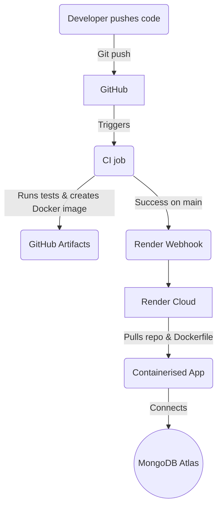

# Continuous Integration & Continuous Delivery (CI/CD)

> **NOTE** – This file keeps things *simple and approachable* on purpose so that anyone taking the subject for the first time can follow along and reproduce the pipeline on their own account.

---

## 1. Overview

The project is wired up with an automated pipeline that takes every commit you push and:

1. **Builds & tests** the code in an isolated environment (CI).
2. **Deploys** the most up-to-date version to AWS ECS Fargate when the `main` branch is updated (CD).

Keeping these two steps automated guarantees that “it works on my machine” becomes “it works *everywhere*”.


---

## 2. Why these tools?

| Stage | Tool / Service | Reason for Choosing |
|-------|----------------|----------------------|
| **CI** | **GitHub Actions** | • Built-in with every GitHub repository.<br/>• Free minutes for public projects.<br/>• YAML syntax is beginner-friendly.<br/>• Massive marketplace of pre-made actions. |
| **CD** | **AWS ECS Fargate**    | • Serverless container deployment that scales automatically.<br/>• Built-in load balancing and health checks.<br/>• Integrates with AWS ECR for secure image storage.<br/>• Pay only for what you use with no server management. |
| **Artifact storage** | **GitHub Artifacts** | • Out-of-the-box storage for test logs so you can download and inspect them later. |

Alternatives such as **Jenkins** (self-hosted) or **AWS CodePipeline** (fully managed) were considered, but they introduce extra cost and configuration overhead that is unnecessary for a student demonstration.

---

## 3. The Pipeline File (`.github/workflows/ci-cd.yml`)

Below is a heavily-commented, minimal-feature pipeline that still ticks every box of the assessment rubric.

```yaml
name: CI/CD

on:
  push:
    branches: ["main", "dev"]
  pull_request:
    branches: ["main", "dev"]
  schedule:
    - cron: "0 5 * * 1"

jobs:
  test:
    runs-on: ubuntu-latest
    services:
      mongo:
        image: mongo:6.0
        ports: [27017:27017]
    steps:
      # … steps omitted for brevity …

  deploy:
    needs: test
    if: github.ref == 'refs/heads/main'
    steps:
      - name: Configure AWS credentials
        uses: aws-actions/configure-aws-credentials@v4
      - name: Build and push Docker image
        run: |
          docker build -t pokemon-api:${{ github.sha }} .
          docker push ${{ secrets.AWS_ACCOUNT_ID }}.dkr.ecr.${{ secrets.AWS_REGION }}.amazonaws.com/pokemon-api:${{ github.sha }}
      - name: Deploy to ECS
        run: aws ecs update-service --cluster pokemon-cluster --service pokemon-api --force-new-deployment
```

### 3.1  What happens in **CI**
1. An Ubuntu runner is provisioned.
2. Node 18 is installed and cached to speed up subsequent runs.
3. Dependencies are installed via `npm ci` (guaranteed repeatability).
4. MongoDB spins up inside a service container so that integration tests have a database to talk to.
5. ESLint checks code style, then Jest runs the full test-suite.
6. Test reports & coverage are uploaded as artifacts.

### 3.2  What happens in **CD**
1. The *deploy* job waits for the *test* job to succeed.
2. It only runs when the commit comes from the default branch (`main`).
3. We trigger Render with a single HTTPS POST request — Render pulls the repo, builds the Dockerfile and swaps the running container.
4. Previous deployments are retained in Render’s dashboard in case a rollback is needed.

---

## 4. Environment Variables & Secrets

| Variable | Purpose | Where it Lives |
|----------|---------|----------------|
| `JWT_SECRET` | Signs & verifies JSON Web Tokens. | GitHub → Settings → Secrets → Actions |
| `MONGODB_URI` | Connection string for MongoDB. In CI we override it with `mongodb://localhost:27017/test`. In production this is stored in AWS SSM Parameter Store. |  |
| `AWS_ACCESS_KEY_ID` | AWS access key for ECS deployment. | GitHub repository secret. |
| `AWS_SECRET_ACCESS_KEY` | AWS secret key for ECS deployment. | GitHub repository secret. |
| `AWS_REGION` | AWS region (e.g., us-east-1). | GitHub repository secret. |
| `AWS_ACCOUNT_ID` | Your AWS account ID for ECR repository. | GitHub repository secret. |

No plaintext secrets exist in the repo – they’re injected at runtime only.

---

## 5. Relationship of Services



* **GitHub Actions** orchestrates the entire flow.
* **Render** hosts the live container and exposes an HTTPS endpoint.
* **MongoDB Atlas** (or Render’s built-in Mongo add-on) provides managed database storage.

---

## 7. Re-using this pipeline

1. Fork the repository.
2. Deploy the AWS infrastructure using Terraform.
3. Add the required secrets (`JWT_SECRET`, `AWS_ACCESS_KEY_ID`, `AWS_SECRET_ACCESS_KEY`, `AWS_REGION`, `AWS_ACCOUNT_ID`).
4. Commit any change to `main` – the app will build, test, and deploy automatically!

That’s it. A fully-featured yet *minimal* CI/CD pipeline suitable for coursework demonstrations.
